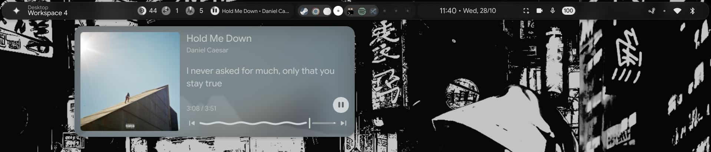

# end4-quickshell-lyrics

A small tweak to [End-4's Quickshell config](https://github.com/end-4/dots-hyprland), adding synced lyrics to the media controls.

Lyrics come from [LRCLIB](https://lrclib.net/).

## Preview




## Install

> Back up your current Quickshell config first, just in case.

1. Make sure [Quickshell](https://quickshell.org/) is installed.
2. Clone this repo:

   ```bash
   git clone https://github.com/esrahm/end4-quickshell-lyrics.git
   ```

3. Copy the `ii` config into your Quickshell config directory. For example, if Quickshell uses `~/.config/quickshell/ii` on your setup:

   ```bash
   mkdir -p ~/.config/quickshell
   cp -r end4-quickshell-lyrics/quickshell/ii ~/.config/quickshell/ii
   ```

4. Restart Quickshell to load the new config.

If your Quickshell config lives somewhere else, change the destination path in the command above.

## Credits

| Project                                                       | Author                                            |
| ------------------------------------------------------------- | ------------------------------------------------- |
| [end-4 dots-hyprland](https://github.com/end-4/dots-hyprland) | [end-4](https://github.com/end-4)                 |
| [Lrclib](https://lrclib.net/)                                 | [tranxuanthang](https://github.com/tranxuanthang) |

This repo only changes the media-related part of the original config. Check the original project for its license and attribution requirements.

## License

See [`LICENSE`](LICENSE).
